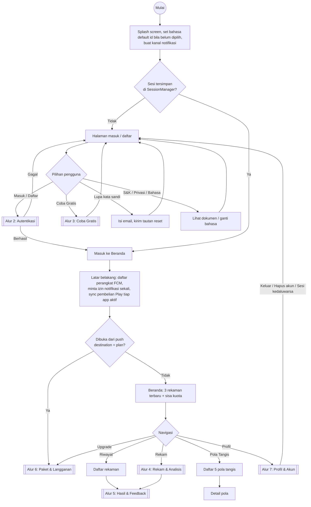
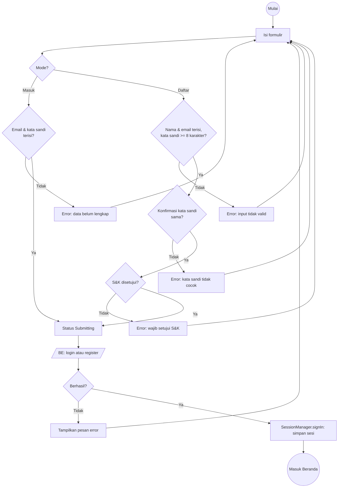
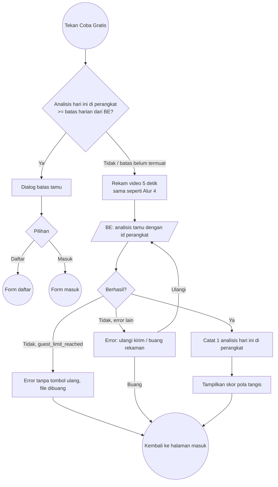
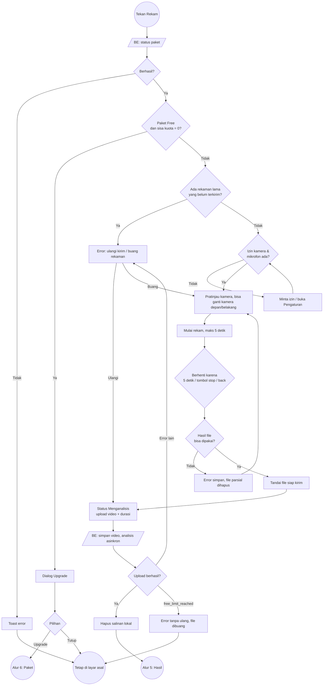
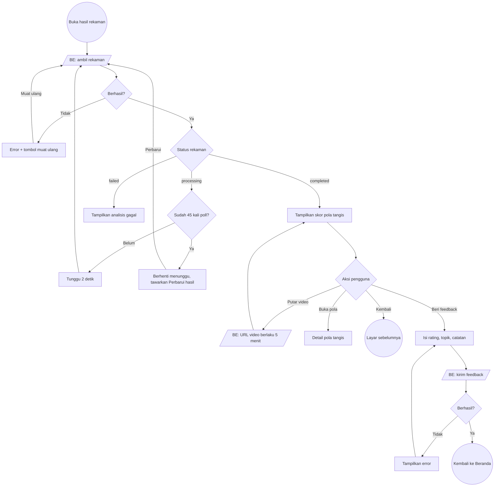
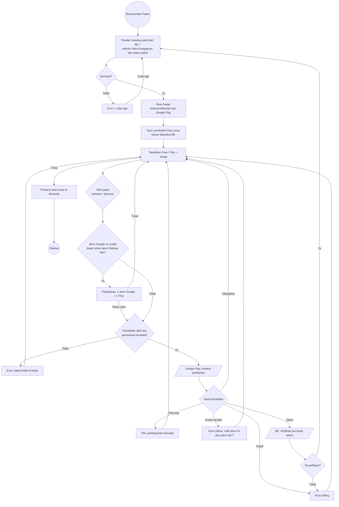
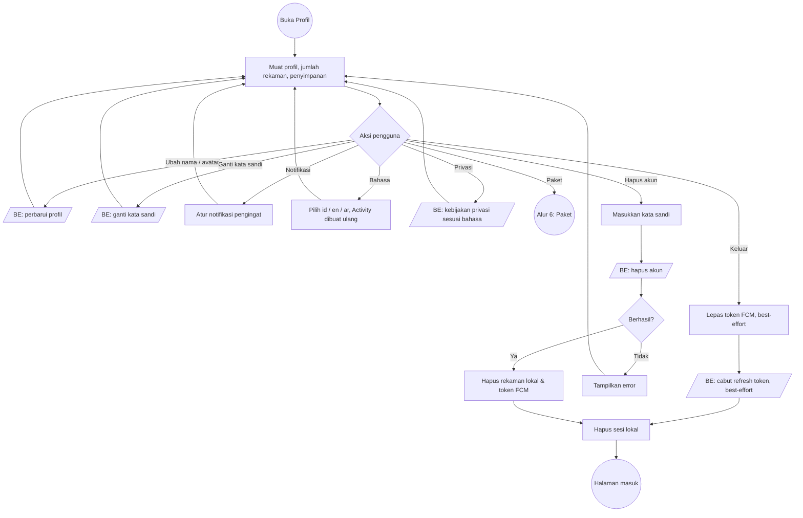

# Activity Diagram — Madsaz (Android)

Diagram diturunkan dari kode di `app/src/main/java/id/madsaz/app/` (bukan dari asumsi). Format Mermaid; GitHub dan
Android Studio (plugin Mermaid) merendernya langsung.

Notasi: `(( ))` = mulai/selesai, `[ ]` = aktivitas, `{ }` = keputusan, `[/ /]` = aktivitas di sistem lain (BE / Google Play).

## 1. Ringkasan: buka aplikasi sampai fitur utama

Sumber: `MainActivity.kt`, `MadsazApp.kt`, `feature/auth/AuthViewModel.kt`.

## 2. Autentikasi (masuk / daftar)

Sumber: `AuthViewModel.authenticate`.

## 3. Coba Gratis (tamu)

Sumber: `SignedOutApp.kt`, `GuestApi`, `GuestDevice`.

## 4. Rekam & Analisis (pengguna masuk)

Sumber: `MadsazApp.openRecorder`, `RecordingRoute.kt`, `RecordingViewModel.kt`.

## 5. Hasil & Feedback

Sumber: `ResultViewModel.kt` (poll tiap 2 detik, maks 45x), `FeedbackViewModel.kt`.

## 6. Paket & Langganan (Google Play Billing)

Sumber: `PlanViewModel.kt`, `data/billing/PlayBilling.kt`.

## 7. Profil & Akun

Sumber: `ProfileScreen.kt`, `AuthViewModel.logout` / `deleteAccount`, `ChangePasswordViewModel.kt`.

